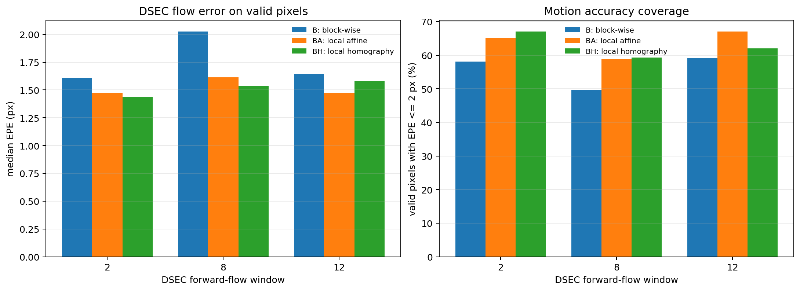

# DVS Event-Only Motion Compensation on DSEC

CPU-first feasibility validation for the event preprocessing stage in the
proposal **"Edge-Based Dual Stereo Sensing System: Fusion of CIS and DVS
Cameras for Real-Time Obstacle Detection and Depth Estimation."**

This repository tests **motion compensation of the DVS event image itself**.
It does not deblur a CIS RGB image, perform image-to-event reconstruction, or
estimate dense optical flow with a neural network.

## Frozen status

The algorithm, parameters, dataset windows, metrics, and final figures are
frozen at `experiment-v0.4-homography`.

| model | composition | status |
|---|---|---|
| **B** | block-wise translation | validated baseline |
| **BA** | B fallback + local affine | **current default** |
| **BH** | B fallback + independent local homography | neutral optional result |
| **B3** | B + A + H hybrid | not implemented; deferred |

BH does not read or blend BA. B provides initialization and fallback for both
local models. No parameter tuning or new model work is planned in this stage.

## Implemented motion models

For an event window, events are split into nine signed temporal bins and
warped toward the window midpoint. The endpoint displacement field is `v(x,y)`.
Dense fields come from block-wise, affine ECC, or homography ECC estimation.

| model | estimation | fallback |
|---|---|---|
| constant translation | variance objective over one local patch | none |
| B | phase correlation + bounded contrast refinement on `64 x 64` tiles | global translation |
| BA | B initialization + `160 x 160` ECC affine regions | B field |
| BH | B initialization + `160 x 160` independent ECC homography regions | B field |

Accepted local regions are tapered into the B field. Rejected BA or BH regions
retain B exactly. DSEC forward flow is used only for evaluation, never inside
the optimizer.

The baseline report, current dense results, parameters, and residual analysis
are in:

- [`reports/feasibility_report.md`](reports/feasibility_report.md);
- [`reports/blockwise_translation_report.md`](reports/blockwise_translation_report.md);
- [`reports/local_affine_report.md`](reports/local_affine_report.md);
- [`reports/homography_report.md`](reports/homography_report.md).

## DSEC sample

The experiment uses the smallest practical driving sequence:

- sequence: `thun_00_a`, left event camera;
- event archive: about 299 MB;
- forward optical-flow labels: about 12 MB;
- event-camera resolution: 640 x 480.

Files are downloaded at runtime from the official
[DSEC download page](https://dsec.ifi.uzh.ch/dsec-datasets/download/).
Dataset license: CC BY-SA 4.0.

## Final results

All three dense models use the same DSEC sequence and windows.

| window | B median EPE | BA median EPE | BH median EPE | B <= 2 px | BA <= 2 px | BH <= 2 px |
|---:|---:|---:|---:|---:|---:|---:|
| 2 | 1.61 px | 1.47 px | 1.44 px | 58.1% | 65.2% | 67.0% |
| 8 | 2.03 px | 1.61 px | 1.53 px | 49.6% | 58.9% | 59.3% |
| 12 | 1.64 px | 1.47 px | 1.58 px | 59.0% | 67.1% | 62.0% |
| mean | 1.760 px | **1.519 px** | 1.517 px | 55.6% | **63.7%** | 62.8% |

BA is the default because it has the best sub-2-pixel coverage, better mean EPE,
and no Window 12 regression. BH's `0.002 px` mean median-EPE advantage is not a
robust improvement.



Historical baseline result for three 100 ms windows and three 128 x 128 patches:

| metric | result |
|---|---:|
| median endpoint error vs. DSEC flow | 1.35 px |
| mean endpoint error | 3.37 px |
| median event-image variance gain | 3.66x |
| mean gradient-energy gain | 8.51x |
| benchmark runtime after inputs are cached | 4.63 s |

The baseline patch EPE is not directly comparable with the later dense
per-pixel EPE. The dense experiments evaluate every valid DSEC flow pixel and
therefore supersede the patch-level 1.35 px summary for model selection.

Two patches track DSEC flow consistently. A textured left-side patch is a
deliberate failure case: contrast still increases, but the estimated motion
does not match the patch median because multiple motions coexist. This shows
why a single full-frame translation is insufficient for a moving driving scene
and why the production design should use local/multi-model compensation.

## Colab notebooks

Repository notebooks clone `main` and use a free CPU runtime. The linked
executed Colab copies are frozen historical outputs; the latest homography copy
has also been aligned to `main`.

| stage | notebook | final executed Colab |
|---|---|---|
| constant baseline | [`notebooks/dsec_event_motion_compensation.ipynb`](notebooks/dsec_event_motion_compensation.ipynb) | repository notebook |
| block-wise phase fix | [`notebooks/blockwise_translation.ipynb`](notebooks/blockwise_translation.ipynb) | [Colab](https://colab.research.google.com/drive/1f7KhjyxGqm27Dtg7fNGbjq9gGpetpj3V) |
| local affine | [`notebooks/local_affine.ipynb`](notebooks/local_affine.ipynb) | [Colab](https://colab.research.google.com/drive/14mlnk92BMVWoRsIjAudiT45A4MhIl1w8) |
| local homography | [`notebooks/homography.ipynb`](notebooks/homography.ipynb) | [Colab](https://colab.research.google.com/drive/1na8VvraDsmXwcJtxwUn9tQRBqmeukroN) |

The homography notebook is the latest integrated B/BA/BH run.

## Reproduce

```bash
python -m venv .venv
source .venv/bin/activate
python -m pip install -r requirements.txt
python -m pip install pytest
python -m pytest -q tests
python scripts/validate_repository.py
mkdir -p work/reproduced

python scripts/run_dsec_demo.py \
  --data-dir data --output-dir work/reproduced/baseline \
  --flow-indices 2 8 12
python scripts/run_blockwise_demo.py \
  --data-dir data --output-dir work/reproduced/blockwise \
  --flow-indices 2 8 12 --tile-size 64 --stride 32
python scripts/run_local_affine_demo.py \
  --data-dir data --output-dir work/reproduced/local_affine \
  --flow-indices 2 8 12 --tile-size 64 --stride 32
python scripts/run_homography_demo.py \
  --data-dir data --output-dir work/reproduced/homography \
  --flow-indices 2 8 12 --tile-size 64 --stride 32
```

The first run downloads about 299 MB of events and 12 MB of flow/timestamps.
Later runs reuse `data/`. Committed frozen results remain under `outputs/`.
[`outputs/checksums.sha256`](outputs/checksums.sha256) records every frozen
result and figure.
Replay is deterministic on the same software stack; CPU, OpenCV, and SIMD
differences can change low-order digits while retaining the reported metrics.

## Scope and limitations

- The experiment validates the algorithm and CPU data path, not RK3588
  deployment latency.
- The 100 ms DSEC windows are intentionally more aggressive than the likely
  10-50 ms windows on the eventual hardware.
- A constant-translation patch model cannot represent rotation, depth
  parallax, or independently moving objects.
- The contrast objective can select a coherent sub-population rather than the
  patch median; flow-supervised evaluation is therefore necessary.
- Near-field parallax, non-planar depth, and independently moving layers remain
  in the lower-left patch for BA and BH.
- A B3 hybrid, neural estimation, new parameter tuning, and RK3588 porting are
  outside the frozen scope.

## Experiment stages

The stable constant-translation baseline is tagged `baseline-v0.1.0`.
Subsequent work is isolated on retained experiment branches and enters `main`
only after its synthetic and DSEC validation passes.

| stage | retained branch | tag | status |
|---|---|---|---|
| constant baseline | `main` | `baseline-v0.1.0` | validated |
| motion-model research | `docs/motion-model-research` | — | historical design note |
| block-wise translation | `exp/blockwise-translation` | `experiment-v0.2-blockwise` | validated |
| phase initialization fix | `fix/blockwise-phase-initialization` | `blockwise-v0.2.1-phase-fix` | validated |
| local affine | `exp/local-affine` | `experiment-v0.3-local-affine` | validated; **default** |
| local homography | `exp/homography` | `experiment-v0.4-homography` | validated; neutral/optional |

All experiment branches are retained. No pushed history is rewritten or deleted.

## Citations

If this experiment is used academically, cite:

```bibtex
@article{Gehrig21ral,
  author  = {Mathias Gehrig and Willem Aarents and Daniel Gehrig and Davide Scaramuzza},
  title   = {DSEC: A Stereo Event Camera Dataset for Driving Scenarios},
  journal = {IEEE Robotics and Automation Letters},
  year    = {2021},
  doi     = {10.1109/LRA.2021.3068942}
}
```
