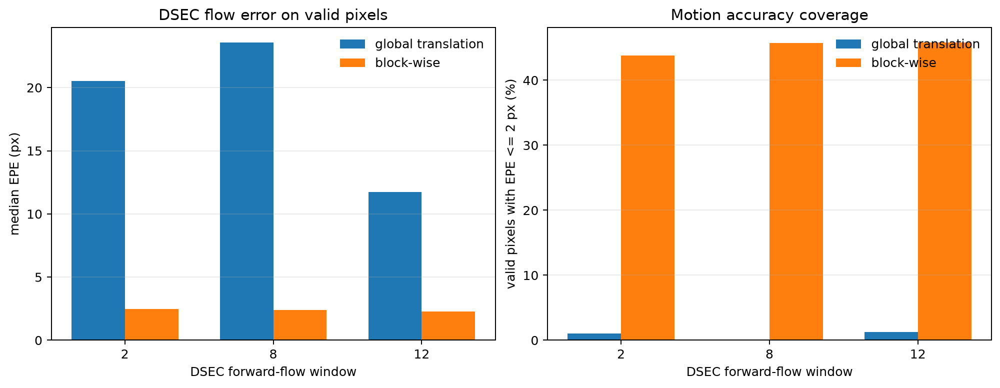

# Block-wise Translation Experiment

## Scope

This experiment replaces one global translation with overlapping local
translations while retaining the event-only contrast objective.

No affine or homography model is used.

## Configuration

- DSEC sequence: `thun_00_a`, left event camera;
- windows: forward-flow indices `2`, `8`, and `12`;
- window duration: approximately 100 ms;
- event volume: 9 temporal bins with signed polarity;
- tile size: `64 x 64`;
- tile stride: `32`;
- phase-correlation initialization: first and last 3 bins;
- contrast refinement: +/-3 px around the phase-correlation vector;
- block displacement bound: +/-48 px;
- output field: bilinear interpolation through overlapping tile centers;
- low-support tiles: global-translation fallback and nearest valid neighbor.

## Result

The primary evaluation compares predicted endpoint displacement with DSEC
forward flow at every valid labeled pixel. The previous baseline evaluation
used a median flow vector per patch, so the new dense per-pixel EPE is stricter
and should not be compared directly with the old 1.35 px patch result.

| window | global median EPE | block-wise median EPE | global <= 2 px | block-wise <= 2 px | warp coverage |
|---:|---:|---:|---:|---:|---:|
| 2 | 20.51 px | 2.47 px | 1.0% | 43.8% | 99.1% |
| 8 | 23.58 px | 2.39 px | 0.8% | 45.8% | 99.3% |
| 12 | 11.73 px | 2.26 px | 0.8% | 45.8% | 99.2% |
| mean | 18.61 px | 2.37 px | 0.8% | 45.1% | 99.2% |

The mean median-EPE reduction is approximately 87%. The full 640 x 480 event
image is therefore working as a first block-wise baseline.

After inputs are cached, all three windows take about 40 seconds on the local
ARM CPU, or about 13 seconds per 100 ms window. The implementation is a Python
reference implementation, not yet an optimized real-time path.

On a free Colab x86 CPU runtime, the same three windows take approximately
190.9 seconds after data preparation, or 59.7-62.4 seconds per 100 ms window.
The complete first Colab run, including the 299 MB event download, took about
3 minutes 37 seconds and remained within the 12.67 GB runtime memory limit.

## Visual result

The block-wise compensated image preserves substantially more structure than a
single global translation. Remaining curved and repeated ghost contours are
expected because each tile still assumes pure translation and the 100 ms window
contains rotation and depth change.



## Failure still visible

The high-texture lower-left patch around `(y=240,x=96)` remains difficult. Its
per-pixel flow error is 12.22, 15.78, and 14.99 px across the three windows.
The contrast objective can lock onto a dominant subset of event edges even
when neighboring flow belongs to another local motion.

This does not invalidate the full-frame result, but it prevents claiming that
block-wise translation alone is a complete solution. Local affine is the next
appropriate model for the remaining rotation/scale residual; homography should
remain deferred until a specific planar region is targeted.

## Acceptance evidence

- synthetic phase-correlation test passes;
- synthetic two-region translation test passes;
- existing constant-translation test passes;
- complete DSEC replay executes without error;
- warp coverage is above 99%;
- block-wise median EPE is below 2.5 px in all three evaluation windows;
- all result data and representative images are generated from one command.

## Reproduce

```bash
python scripts/run_blockwise_demo.py \
  --data-dir data \
  --output-dir outputs/blockwise \
  --flow-indices 2 8 12 \
  --tile-size 64 \
  --stride 32
```
