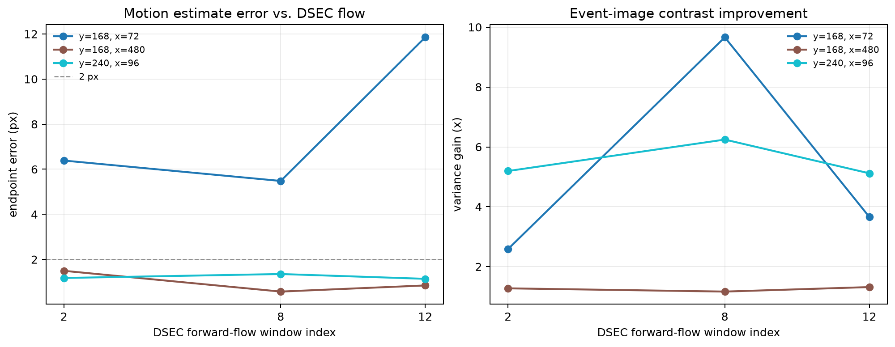

# DVS Event-Only Motion Compensation Feasibility

Status: validated historical baseline. The constant-translation model is the
`baseline-v0.1.0` reference; current model selection is maintained in the
block-wise, affine, and homography reports.

## Question

Can the event-image motion-compensation procedure in presentation page 15 be
validated without the RK3588, a DVS camera, or a CIS-DVS rig, and can it run
within free Colab CPU constraints?

## Conclusion

Yes for algorithm and data-path feasibility. The event-only path runs end to
end on DSEC without RGB input or model training. Local constant translation is
recovered accurately in favorable patches, and event-image variance and
gradient energy increase after compensation.

No for a single full-frame translation as the final production model. DSEC
driving scenes contain rotation, depth parallax, and moving objects. A
contrast-only objective can improve sharpness while selecting the wrong local
motion. The next validation should use block-wise or affine/homography models.

## Experiment

- Dataset: DSEC `thun_00_a`, left event camera.
- Timelines: three official 100 ms forward-flow windows per run.
- Spatial evaluation: three 128 x 128 patches.
- Temporal bins: 9.
- Search: +/-24 px coarse search at 4 px stride, then +/-4 px refinement at
  1 px stride and parabolic sub-pixel interpolation.
- Hardware: local ARM CPU; no CUDA, no neural network.
- Total benchmark runtime after caching inputs: 4.63 s.

## Quantitative result

| patch center `(y, x)` | mean endpoint error | interpretation |
|---|---:|---|
| `(168, 480)` | 0.97 px | good, small motion |
| `(240, 96)` | 1.22 px | good, large dominant motion |
| `(168, 72)` | 7.91 px | failure under multiple motions |
| all nine cases, median | 1.35 px | usable local-translation baseline |

Median variance gain is 3.66x. Mean gradient-energy gain is 8.51x. The left
textured patch has high sharpness gain but poor flow agreement, which is the
central warning: contrast gain alone cannot establish motion correctness.

## Engineering constraints

- The 299 MB DSEC archive downloads and extracts within normal free Colab disk
  limits.
- Only one event window is materialized at a time, around 0.95-1.14 million
  events in this sample.
- Baseline runtime dependencies are NumPy, h5py, hdf5plugin, SciPy, Matplotlib
  and a pure-Python PNG reader; affine and homography add OpenCV headless.
- The current code is a validation baseline, not an optimized real-time
  implementation. RK3588 latency, power, and live-sensor timestamp behavior
  remain future measurements.

## Follow-up completed

The historical next step was completed: block-wise translation replaced the
single full-frame vector and was evaluated on dense DSEC flow. Local affine and
local homography followed as independent experiments. Further model work is
frozen; later validation should use shorter event windows and hardware data
without changing the present results.
