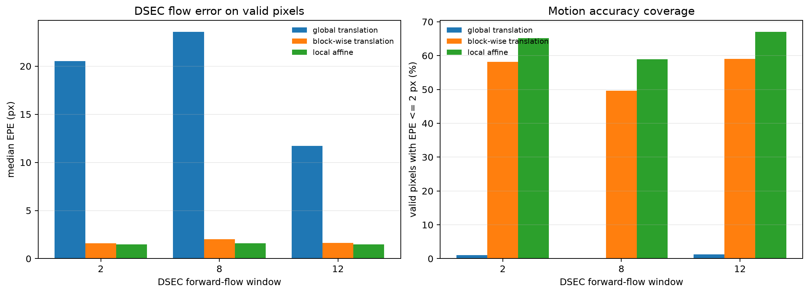

# Local Affine Experiment

## Scope

This experiment adds local 6-DoF affine motion on top of the validated
block-wise translation baseline:

```text
vx(x, y) = a*x + b*y + c
vy(x, y) = d*x + e*y + f
```

Homography and neural networks are not used.

## Method

- block-wise translation remains the stable dense fallback;
- affine regions are `160 x 160` pixels with `80` px stride;
- event images use the first/last three temporal bins;
- OpenCV ECC estimates the affine transform with the block-wise local median
  as initialization;
- affine coefficients are converted to endpoint displacement per full event
  window;
- a region is blended into the dense field only when:
  - ECC correlation is at least `0.30`;
  - the estimated motion is within the `+/-48 px` endpoint bound;
  - motion variation inside the region is at most `24 px`;
  - affine event-image variance is at least `1.02x` the block-wise baseline.

Overlapping accepted regions are blended with an edge taper. Rejected regions
remain exactly on the block-wise baseline.

## Result

The same DSEC sequence, windows, local affine tile estimate, and dense
per-pixel flow evaluation are used as the block-wise baseline.

| window | block median EPE | local-affine median EPE | block <= 2 px | affine <= 2 px | accepted affine regions |
|---:|---:|---:|---:|---:|---:|
| 2 | 1.61 px | 1.47 px | 58.1% | 65.2% | 4 / 35 |
| 8 | 2.03 px | 1.61 px | 49.6% | 58.9% | 11 / 35 |
| 12 | 1.64 px | 1.47 px | 59.0% | 67.1% | 7 / 35 |
| mean | 1.76 px | 1.52 px | 55.6% | 63.7% | - |

The full model is selective: only regions with both stable ECC convergence and
better event contrast than block-wise translation are modified.



## Target patch

At the previously problematic lower-left patch:

| window | block-wise | local affine |
|---:|---:|---:|
| 2 | 1.39 px | 1.39 px |
| 8 | 2.65 px | **1.94 px** |
| 12 | 1.76 px | 1.76 px |

The affine model improves the middle window but does not fully remove the
residual. This is consistent with near-field parallax and non-linear motion
inside the patch, which a single local affine model cannot represent.

## Limitations

- ECC is sensitive to initialization and event-image correlation.
- The contrast gate is conservative and accepts only a subset of regions.
- A single local affine cannot model multiple motion layers or strong depth
  parallax.
- The Python implementation is not an RK3588 real-time implementation.

## Acceptance evidence

- block-wise translation tests pass;
- synthetic affine field recovery passes;
- synthetic event-image ECC affine test passes;
- complete DSEC replay is generated for windows 2, 8, and 12;
- mean median EPE improves from 1.76 to 1.52 px;
- mean EPE <= 2 px agreement improves from 55.6% to 63.7%;
- rejected regions retain the validated block-wise fallback.

## Reproduce

```bash
python scripts/run_local_affine_demo.py \
  --data-dir data \
  --output-dir outputs/local_affine \
  --flow-indices 2 8 12 \
  --tile-size 64 \
  --stride 32
```
